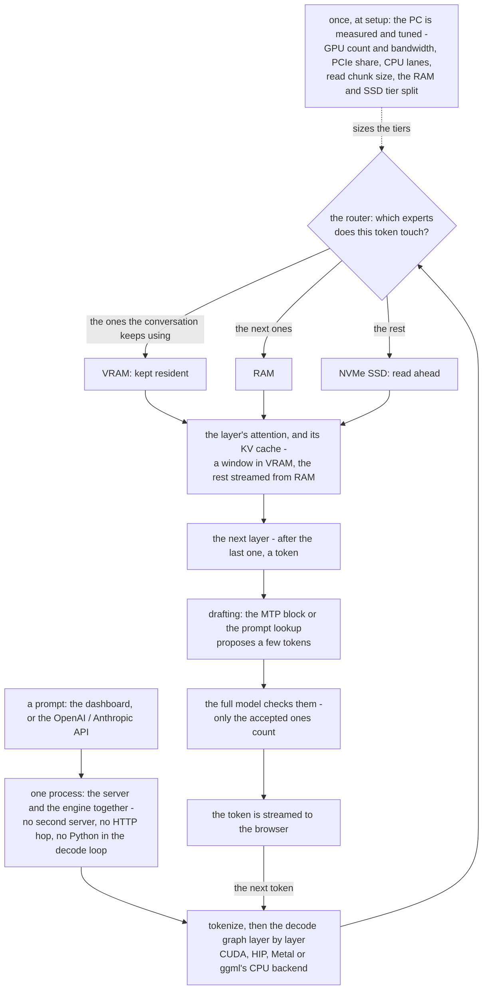
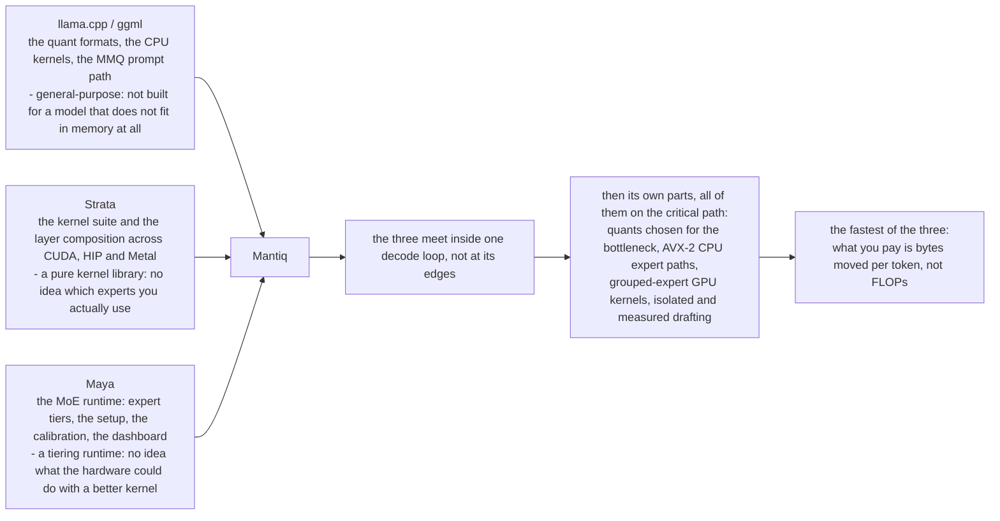

<p align="center"></p>

<h1 align="center">Mantiq</h1>

<p align="center"><b>A fast inference engine for large MoE models, on the hardware you already own</b><br>
Qwen3.5/3.6-MoE (35B-A3B) · GLM-5.3-Flash · DeepSeek-V4.1-Flash-1017 · MiniMax-M3.1-Flash · private, local, nothing leaves your machine</p>

Mantiq is an inference engine. It is not a wrapper around someone else's runtime, and it is not a model server that
hands the work to a library: it *is* the runtime - the kernels, the memory tiers, the tuner, the server and the
dashboard, in one process on one machine.

## What the engine does

A model this size does not fit in VRAM. Mantiq plans around that instead of pretending otherwise:

- **It tiers the experts.** The ones your conversation keeps touching stay in VRAM, the next ones in RAM, the rest on
  the NVMe SSD, and they move between the tiers as you chat - so a 321 B, a 428 B or a 748 B model runs on a desktop.
- **It measures the machine and tunes itself.** GPU count and bandwidth, PCIe share, CPU lanes, read chunk size and RAM
  tier split are calibrated per PC, per model and per context (`--calibrate`), then kept.
- **It moves as few bytes per token as it can.** The decode path is bound by memory traffic, so the quant formats, the
  cache and the expert reads are what the engine is built around - not the arithmetic.
- **It is one runtime end to end.** From the browser to the kernel there is no second server, no HTTP hop in the middle
  and no Python in the decode loop.
- **It serves you, not just the model.** A chat and a live Monitor in the browser, pictures on every model, thinking
  levels, an OpenAI- and Anthropic-compatible API with streamed tool calls, and several requests answered at once.

## How it works

One prompt, one process, and a token that is read from the tier the engine decided on:



Where a token is read from is the engine's own decision, made per layer and per token: nothing about it is left to a
library, and the bytes it does not need are bytes it never reads.

## Built on three projects

Mantiq did not start from nothing. It stands on three engines, and it takes a specific thing from each of them:

| Project | What Mantiq keeps |
| --- | --- |
| **Strata** | The engine's backbone: the kernel suite and the layer composition - the decode graph, the backend dispatch across CUDA / HIP / Metal, and the shape of a layer done in the right order with the right buffers. |
| **Maya** | The project Mantiq carried over from and renamed: the MoE runtime around the kernels - the expert tiers, the setup that checks a PC and builds once, the calibration, and the browser dashboard. Every "Maya-*" quant name is still accepted as an alias. |
| **llama.cpp / ggml** | The quantization formats and the CPU side of the engine: `ggml`'s K-quants and I-quants, the CPU dot-product kernels, the MMQ prompt-prefill kernels and the GGUF reader, built from a pinned upstream commit. |

The three are not glued together at the edges - they meet inside one engine. Strata's layers call into `ggml`'s
quantized kernels, Maya's tiering decides which of them a token ever touches, and Mantiq's own kernels
(per-architecture CPU expert paths, EXL3 and IQ/Q2_K decode on the GPU, MTP and prompt-lookup drafting) fill the gaps
the other three leave on desktop hardware.

## Why it is the fastest of the three



Taken one at a time, each of the three is fast at the thing it was built for and slow at the rest: a pure kernel
library has no idea which experts you actually use, a tiering runtime has no idea what the hardware could do with a
better kernel, and a general-purpose CPU engine is not built for a model that does not fit in memory at all. Mantiq is
the fastest of the three because it is the three *combined and tuned*, and because the parts it adds are all on the
critical path:

- **The quant is chosen for the bottleneck.** Decode speed is bytes moved, so the engine ships its own quants
  (IQ2_XXS-class experts, Q4_K attention, EXL3 tiles) that read less per token than a stock format while staying close
  to the original's answers.
- **The tiering is what makes the model run at all.** Speculative read-ahead, expert caching and a calibrated RAM /
  PCIe / SSD split turn "does not fit" into a steady decode rate - a runtime that cannot do this does not finish the
  sentence.
- **The kernels are tuned for this class of GPU.** AVX-2 CPU expert paths (including hand-written Q6_K down
  projections), grouped-expert GPU kernels for IQ/Q2_K, EXL3 decoding and fused MoE prefill - work aimed at cards of
  8-24 GB, not at datacenter shapes.
- **Drafting is a first-class, measured switch.** MTP and prompt-lookup drafting are isolated from each other so each
  one's acceptance rate is measured rather than guessed, and the fastest settings for a model are one button away.
- **It never leaves the machine.** Every token is served from your own GPU, RAM and disk - no cloud round trip, no
  queue, no bill.

Measure yours with `./mntq.sh --bench` (decode and prefill), and `./mntq.sh --report` to write the machine's numbers to
`mntq-report.txt`. Speeds from other users' machines are welcome in a
[GitHub issue](https://github.com/dahanco/mantiq/issues).

## Quick start

```sh
git clone https://github.com/dahanco/mantiq.git && cd mantiq
./setup.sh
```

The setup asks which model you want, downloads it, builds everything once, **starts the model**, and leaves a dashboard
at `http://127.0.0.1:7711`. Windows: `START-MNTQ.bat` instead of `./setup.sh`. Every option (GPUs, context, an existing
model folder, remote access, ...) is a question the setup asks; Enter takes the recommended answer.

**Requirements in short:** an NVIDIA GPU of compute capability 7.0 or newer (one, or several that share the model),
32 GB of RAM, and **a fast NVMe SSD** with room for the model. AMD (ROCm) and Windows are supported experimentally,
and Apple Silicon through Metal for GLM-5.3-Flash. The setup checks all of it and prints the exact command for anything
missing; it installs nothing system-wide.

### Prebuilt packages (Windows, nothing to build)

Two ready-to-run packages are published with every [release](https://github.com/dahanco/mantiq/releases/latest). Unzip
one, double-click `START-MNTQ.bat`, and the first start asks for the model and downloads it - no compiler, no CUDA
toolkit, no Python to install, and nothing is put on `PATH`:

| Package | Runs on | Inside |
| --- | --- | --- |
| `Mantiq-Portable-CUDA.zip` (about 590 MB) | an NVIDIA PC | the compiled engine (`build\mntq.exe`) with its CUDA libraries, Mantiq's Python and its packages, and the stamped sources the engine was built from |
| `Mantiq-Portable-CPU.zip` (about 45 MB) | any 64-bit PC, no GPU needed | the same dashboard on `ggml`'s CPU engine (`build-cpu\mntq-cpu.exe`) and the same Python |

Neither one carries a model: nothing is downloaded until the start asks, and a GGUF you already have can be added
instead (below).

## Models that run on it

Every link goes to the publisher's own repository, where the files, the license and the quant's card are. The setup
downloads the ones it offers itself when it asks which model you want; a GGUF you already have is added by hand.

**The smaller ones: 35B-A3B Qwen MoE.** The setup ships two of them (Qwen-3.8-35B-A3B, the distill, and
Qwen-3.6-35B-A3B, Escha-W2), and any other file of the same shape runs just as well: download the GGUF, then the
dashboard's Models page has the button, or `./mntq.sh --add-local-model <file.gguf>`. Mantiq serves it on the Qwen path:

| Model | Repository |
| --- | --- |
| Qwopus3.6-35B-A3B Coder, with its MTP draft block | [Jackrong/Qwopus3.6-35B-A3B-Coder-MTP-GGUF](https://huggingface.co/Jackrong/Qwopus3.6-35B-A3B-Coder-MTP-GGUF/tree/main) |
| Qwen-35B-A3B SignOfFour Coder | [pragmaticcs/Qwen-35B-A3B-SignOfFour-Coder-GGUF](https://huggingface.co/pragmaticcs/Qwen-35B-A3B-SignOfFour-Coder-GGUF/tree/main) |

**The Maya line: GLM-5.3-Flash quantized for this engine.** These are the large ones the tiering and the calibration
exist for; the setup's ids are Mantiq's now and the folders on Hugging Face still carry Maya's names - both are accepted.

| Quant | Size | What it is | Repository |
| --- | --- | --- | --- |
| `Mantiq-XS-IQ1_S` (Maya-XS) | 73.4 GB | the smallest of them: a 64 GB PC with a 24 GB card at 128K context | [Maya-XS](https://huggingface.co/peasantsmith/GLM-5.3-Flash-Maya-GGUF/tree/main/Maya-XS) |
| `Mantiq-S24` (Maya-S24) | 94.7 GB | about 1.5 GB less that stays on the GPU, so 24 GB cards hold more experts (about 14% faster decode there) | [Maya-S24](https://huggingface.co/peasantsmith/GLM-5.3-Flash-Maya-GGUF/tree/main/Maya-S24) |
| `Mantiq-S-v2-IQ2_XXS` (Maya-S) | 96.5 GB | the compact one: error-feedback-rounded IQ2_XXS experts, IQ2_S / IQ3_XXS down projections, Q6_K attention, the MTP draft block | [Maya-S](https://huggingface.co/peasantsmith/GLM-5.3-Flash-Maya-GGUF/tree/main/Maya-S-v2-IQ2_XXS) |
| `Mantiq-M` (Maya-M) | 116.0 GB | IQ2_S gate / up experts, IQ3_XXS down projections (IQ3_S in the most sensitive layers) | [Maya-M](https://huggingface.co/peasantsmith/GLM-5.3-Flash-Maya-GGUF/tree/main/Maya-M) |
| `Mantiq-M-Derisked` | 116.0 GB | Maya-M with a directional weight edit by Blackfrost_AI that reduces blanket refusals (experimental) | [Maya-M-Derisked](https://huggingface.co/peasantsmith/GLM-5.3-Flash-Maya-M-Derisked-IQ2_S-GGUF) |
| `Mantiq-L` (Maya-L) | 156.3 GB | the largest: IQ3_S gate / up experts, IQ4_XS down projections (Q5_K in the most sensitive layers) | [Maya-L](https://huggingface.co/peasantsmith/GLM-5.3-Flash-Maya-GGUF/tree/main/Maya-L) |

GLM-5.3-Flash has published EXL3 quants too - [3.05 bpw](https://huggingface.co/turboderp/GLM-5.3-Flash-exl3/tree/3.05bpw),
[4.05 bpw](https://huggingface.co/turboderp/GLM-5.3-Flash-exl3/tree/4.05bpw),
[sc_4.10 bpw](https://huggingface.co/turboderp/GLM-5.3-Flash-exl3/tree/sc_4.10bpw) - and a
[DFlash2 drafter](https://huggingface.co/Anbeeld/GLM-5.3-Flash-DFlash2-GGUF). DeepSeek-V4.1-Flash-1017 and
MiniMax-M3.1-Flash have quants for this engine of their own, in `peasantsmith`'s `-Mantiq-GGUF` repositories (both are
gated: ask their publisher for access), and the setup offers them like any other model.

## Credits and license

- Mantiq is created and led by [@dahanco](https://github.com/dahanco).
- Built on **[ggml / llama.cpp](https://github.com/ggml-org/llama.cpp)** (MIT License, Copyright (c) 2023-2026 The ggml
  authors): the quantization formats, the CPU dot products and the prompt path's MMQ kernels, from a pinned commit
  (`third_party/ggml/LICENSE`).
- **EXL3 support** follows **[exllamav3](https://github.com/turboderp-org/exllamav3)**'s format, codebooks and
  tensor-core tile decoding (MIT License, Copyright (c) 2025 Turboderp; `third_party/exllamav3/LICENSE`). **The DFlash2
  drafter's forward** follows **[beellama.cpp](https://github.com/Anbeeld/beellama.cpp)** (MIT License, Copyright (c)
  2023-2026 The ggml authors, Anbeeld; `third_party/beellama.cpp/LICENSE`).
- The models and their licenses (GLM-5.3-Flash by zai-org, DeepSeek-V4.1-Flash-1017 by DeepSeek, MiniMax-M3.1-Flash
  under the MiniMax Community License) belong to their authors; the quants here are made from their released weights
  and keep their terms.
- Mantiq is open source under the [MIT License](LICENSE); the notices in [LICENSE](LICENSE) and `third_party/` stay
  with every copy.
